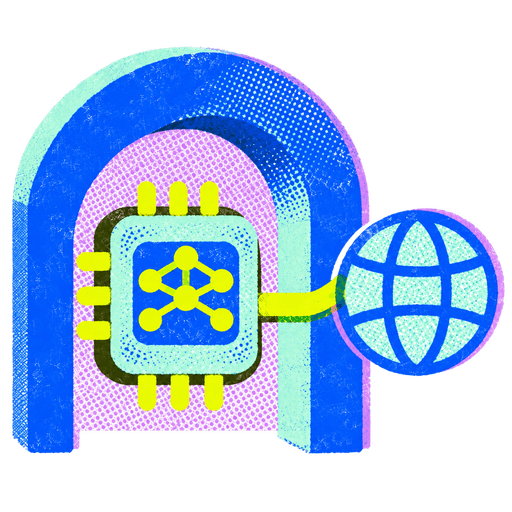

<p align="center">
  
</p>

<h1 align="center">WS Model Proxy</h1>

<p align="center">Self-hosted OpenAI-compatible model routing through outbound websockets.</p>

<p align="center">
  <a href="LICENSE"></a>
  <a href="https://github.com/FlyCockpit/ws-model-proxy/releases"></a>
  <a href="https://nodejs.org"></a>
  <a href="https://www.rust-lang.org/tools/install"></a>
  <a href="https://github.com/FlyCockpit"></a>
</p>

WS Model Proxy (WMP) is a self-hosted web app plus a node client (`wsmp`) that serves the models running on your own computers through one OpenAI-compatible API on a VPS, without router port forwarding. It is for people who run inference servers at home or in a lab and want to call them, share them, or fall back to cloud providers from one endpoint.

## Features

- **Nodes** are computers running `wsmp`. Each keeps one outbound websocket to the server and
  gives it one trust level: **Full control** (the server may define and start runtimes, run
  commands, edit files and open terminals there) or **Relay only** (it only relays requests to
  the runtimes the node already holds, which people can still start and stop).
- **Runtimes** are inference server definitions: **always-on** (an address on a node that is
  just there) or **startable** (commands that start it on one or more nodes, from a preset such
  as vLLM (chat, embeddings or speech-to-text), SGLang, llama.cpp or Docker Compose). Every edit is a new version; a start previews the placement
  (free memory, ports, labels) before you confirm. **Profiles** switch a set of nodes between
  runtime versions in one click.
- **Pools** are what clients call: `owner/pool` routes to served models of your runtimes (and of
  people who contribute theirs), and `owner/pool:external` may also use cloud **providers** under
  a monthly cap when local runtimes are busy. Pools can be shared by e-mail; a person you share
  with can use the pool, contribute their own runtimes to it, or both, and either side can stop.
- **Agents** connect over MCP (OAuth or an agent token) with `read` and optional scopes for
  pools, runtimes, node management, commands, files and model tests. People choose allowed
  owned nodes and can edit access later; shared pools never grant control of another user's
  nodes. Raising node trust, provider accounts and Forget stay with people.
- **OpenAI-compatible API.** `/v1/*` with bearer API keys, including audio transcription and translation, and realtime.
- **Node tools.** Browser terminals, node file tools and node self-update from the **Nodes** page.

WMP keeps content-free usage and routing metadata, never chat content. Native Responses defaults
to `store: false`; backend storage requires explicit caller opt-in. External embeddings need an
exact vector-space contract. See [external fallback](docs/external-fallback.md).

## How it works

One Docker service (Hono server, React web app, oRPC API, MCP server and websocket relay) runs on a VPS with Postgres. Each node runs `wsmp`, which logs in once with `wsmp login` and a one-time enrollment code from the **Nodes** page, then holds one outbound websocket to the server. The server routes `/v1/*` requests for a pool to a runtime on a connected node, and the node proxies them to its local inference server. One node can hold many runtimes, and a multi-node runtime spans several nodes. Request media passes through the proxy.

An MCP (Model Context Protocol) server (`2026-07-28` primary, plus stateless `2025-06-18` compatibility tested with Claude Code 2.1.332 and Codex 0.172.0) exposes dashboard operations to OAuth-authenticated and agent-token clients. It is on by default; set `WMP_MCP_ENABLED=false` to close it — see [docs/mcp.md](docs/mcp.md).

## Quick start

These steps take a fresh deployment to a first API call. The **Get started** page in the web app walks through the same steps.

1. Deploy the web service and Postgres.
2. With public signup disabled, configure `ADMIN_EMAIL` before first use, then create the first admin from that address.
3. **Add a node**: on the **Nodes** page, choose **Add a node** and run the command it shows on
   the computer that runs (or will run) your models. It installs `wsmp` through the server's
   `/install.sh` and runs `wsmp login` with a one-time enrollment code, which asks for the trust
   level and offers to install the per-user service. See [apps/cli/README.md](apps/cli/README.md).
4. **Add a runtime**: on **Runtimes**, choose **New runtime**: a detected or always-on server
   (an address on the node), or a preset (vLLM, SGLang, llama.cpp, Docker Compose, ...) that the server starts
   for you.
5. **Create a pool** from one of the runtime's served models. Its callable ID (`you/pool`) is the
   model name clients send.
6. **Create an API key** under **Access → API keys**, and try the pool on the **Test** page.

Model API clients call `/v1/*` with `Authorization: Bearer ...`. Cookie/session auth and permissive browser CORS are intentionally not supported for those bearer routes in v1.

## Installation

### Server

The app image is published as:

```text
ghcr.io/flycockpit/ws-model-proxy:vX.Y.Z
ghcr.io/flycockpit/ws-model-proxy:X.Y.Z
ghcr.io/flycockpit/ws-model-proxy:sha-<commit-sha>
ghcr.io/flycockpit/ws-model-proxy:latest   # when publish_latest is true
```

For example:

```sh
docker pull ghcr.io/flycockpit/ws-model-proxy:latest
```

The supported v1 runtime is exactly one web service container plus Postgres. The
auth and per-account failed-sign-in rate limits are process-local, so do not
run multiple web replicas until they are moved to a shared durable limiter.
No Redis, S3/R2 object storage, VAPID push service, CMS/MCP service, video
pipeline, docs app, or separate queue process is required in v1.

For a local production smoke test or a VPS behind a reverse proxy, use
[`compose.yaml`](compose.yaml). Supply just `POSTGRES_PASSWORD` (random hex),
`BETTER_AUTH_SECRET` (32+ random characters), `BETTER_AUTH_URL`,
`TRUST_PROXY_HOPS` (your actual proxy count), and `ADMIN_EMAIL` in a private
platform env file, then run:

```sh
docker compose --env-file /path/to/private.env up -d --build
```

The image sets `NODE_ENV=production`, builds both apps, and applies migrations.
The web port binds to loopback on port 3000 (`WEB_PORT` overrides it); put your
HTTPS reverse proxy in front. The server does not compress responses, so enable
compression at the proxy (on Dokploy, add a Traefik `compress` middleware to the
app's domain). On Dokploy, which listens on host port 3000 itself, remove the
`ports:` mapping and attach a domain to service `app`, port 3000. The optional
SMTP settings (`SMTP_HOST`, `SMTP_PORT`, `SMTP_USER`, `SMTP_PASS`, `SMTP_FROM`)
and `WMP_PROVIDER_CREDENTIAL_ENCRYPTION_KEYS` go in the same env file;
`compose.yaml` passes them to the app (an empty value counts as unset; email is on
once `SMTP_HOST` is set). Postgres has persistent storage and no published
port. Public signup remains closed; register with `ADMIN_EMAIL` to bootstrap.
No SMTP, backup settings, backup volume, or backup sidecar are required.
Automatic backups default off and startup logs how to enable them. To opt in
to pre-migration and daily backups with local storage, add the override:

```sh
docker compose --env-file /path/to/private.env -f compose.yaml -f compose.backups.yaml up -d --build
```

The override also passes `BACKUP_S3_*` from the env file to the app and the
backup service for an off-site copy (see
[`docs/backup-and-restore.md`](docs/backup-and-restore.md)).

### Home server behind a Cloudflare Tunnel

A home machine with no public IP can serve the app through a [Cloudflare Tunnel](https://developers.cloudflare.com/cloudflare-one/connections/connect-networks/)
(a named tunnel, Free or Pro plan). `cloudflared` on the machine opens an outbound connection to
Cloudflare; nothing listens on the router and no port is forwarded:

```text
browser / API client / wsmp node
  → https://wsmp.example.com (Cloudflare edge: TLS, your hostname)
  → tunnel (outbound from home)
  → cloudflared on the home machine
  → [optional: Traefik / Caddy / nginx]
  → app on 127.0.0.1:3000 (compose.yaml)  → Postgres (no published port)
```

Nodes connect to the same public hostname (`wss://wsmp.example.com/api/cli/ws`); they need no
inbound ports either. Create the named tunnel either way:

- **Remotely managed:** create it in the Zero Trust dashboard, add the public hostname
  `wsmp.example.com` → `http://127.0.0.1:3000` there, and run the connector with the tunnel
  token. The token is a secret: keep it in your private env file, never in the checkout.
- **Locally managed:** `cloudflared tunnel login`, `cloudflared tunnel create wsmp`,
  `cloudflared tunnel route dns wsmp wsmp.example.com`, then a `config.yml`. A sample
  `~/.cloudflared/config.yml` for `cloudflared` on the host, in front of the shipped
  `compose.yaml`:

```yaml
tunnel: <tunnel-uuid>
credentials-file: /home/you/.cloudflared/<tunnel-uuid>.json
ingress:
  - hostname: wsmp.example.com
    service: http://127.0.0.1:3000
  - service: http_status:404
```

WebSockets need no extra setting. Keep the app reachable only through the tunnel: `compose.yaml`
already publishes it on `127.0.0.1` only. When `cloudflared` runs in Docker instead, put it on
the compose network, use `service: http://app:3000`, and remove the app's `ports:` mapping. Never
publish the app on `0.0.0.0` or a LAN address (Docker's published ports bypass host firewalls
such as `ufw`), and forward no router ports. Keep `config.yml` and the credentials JSON outside
the checkout (for example `/etc/cloudflared`, mounted read-only into the container). The official
`cloudflare/cloudflared` image runs as UID 65532 and the credentials file is readable by its
owner only, so hand both to that UID: `sudo chmod 400 /etc/cloudflared/<tunnel-uuid>.json`,
`sudo chown -R 65532:65532 /etc/cloudflared`, `sudo chmod 700 /etc/cloudflared`; otherwise the
tunnel never connects.

Environment for the tunnel (in your private env file):

| Topology | `TRUST_PROXY_HOPS` | Notes |
|---|---|---|
| `cloudflared` → app | `1` | Cloudflare writes the client address into `X-Forwarded-For`; the app's socket peer is `cloudflared`. |
| `cloudflared` → Traefik / Caddy / nginx → app | `2` | That proxy must append `cloudflared`'s address to the `X-Forwarded-For` it received, not replace it: Traefik with `forwardedHeaders.trustedIPs` covering `cloudflared`'s address, Caddy with `trusted_proxies` covering it, nginx with `proxy_set_header X-Forwarded-For $proxy_add_x_forwarded_for;` (and no `real_ip` module rewriting the client address). The count must equal the number of proxies that append; one too many lets a client choose its own rate-limit key. |

- With a proxy between `cloudflared` and the app, give `cloudflared` a plain-HTTP route to it
  that does not redirect to HTTPS (not an HTTPS entrypoint with `noTLSVerify`; the hop is local),
  make the proxy trust only `cloudflared`'s address for forwarded headers, and keep the proxy's
  own ports off the internet and the LAN: anyone who reaches it could send a forged
  `X-Forwarded-For` through a hop the app trusts.
- `BETTER_AUTH_URL=https://wsmp.example.com` (the tunnel hostname). Leave `CORS_ORIGIN` and
  `MEDIA_PUBLIC_BASE_URL` unset; they default to the same origin. The terminal, Test-page
  realtime and node-events origin checks accept exactly this origin. `PUBLIC_APP_URL` (only read
  by the translation tooling) is the same hostname when you set it.
- `TRUST_PROXY_HOPS=0` would put every client into the tunnel's single rate-limit bucket, and a
  burst of reconnects after an edge restart could trip the per-IP upgrade limits for all of
  them; `pnpm doctor:app` warns about `0` in production.
- The app does not read `CF-Connecting-IP`. The hop count above gives the same client address
  without trusting a header that any client reaching the app directly could set.
- SMTP: home ISPs usually block port 25, so send through a relay (your mail provider or a
  transactional service) on `SMTP_PORT=587` (STARTTLS) or `465` (TLS from the first byte).

Cloudflare limits that matter to this app:

- **100 MB request bodies** (Free/Pro). Only transcription and translation uploads come near it.
  A file may be as large as the smallest of the admin attachment limit (**Admin → Settings**,
  25 MiB by default), the pool's or model's own limit, and the deployment ceiling
  (`MODEL_API_TRANSCRIPTION_MAX_UPLOAD_BYTES`, 90 MiB per file, and
  `MODEL_API_TRANSCRIPTION_MAX_MULTIPART_BYTES`, 91 MiB per request). The ceiling's defaults fit
  under the edge's cap, so an admin can raise the setting all the way: an upload over the ceiling
  but under 100,000,000 bytes gets the server's JSON 413 naming the limits, and only a larger one
  meets the edge's own HTML 413. Do not raise the ceiling past 100,000,000 bytes behind the
  tunnel, or uploads between the two get the edge's HTML 413 instead of the server's answer. Split longer audio (OpenAI's own API takes
  25 MB per file, so OpenAI clients already do). Other bodies are smaller: model API JSON 32 MiB,
  `/v1/files` 25 MiB by default (`MEDIA_MAX_UPLOAD_BYTES`).
- **524 after about 100 s without a response byte.** Slow model API answers are kept alive after
  30 s (see [Slow answers and the keepalive](#slow-answers-and-the-keepalive)). Text, `srt` and
  `vtt` transcriptions, streaming transcriptions and `/v1/audio/speech` are not, so use a JSON
  transcription format for long audio.
- **WebSockets and edge restarts.** Cloudflare closes a WebSocket that is idle for about 100 s
  and drops open ones when its edge restarts. Each socket stays busy and recovers on its own:
  - Node relay (`/api/cli/ws`): `wsmp` sends a heartbeat every 20 s. After a drop it reconnects
    (1 s, doubling to 5 min, with jitter). A pool request that has sent nothing yet may fail
    over to another member; otherwise a request in flight on that node fails: with 503
    (`disconnected`) before its answer started, as the in-body error of a kept-alive answer, or
    cut off if its answer was already streaming. The node's open browser terminals end; node
    commands keep running.
  - Browser terminals: the server pings every 25 s. After a drop the page reconnects (0.5 s to
    15 s) and reattaches its terminals with their scrollback; the shells keep running.
  - `/v1/realtime` live transcription: the server pings every 25 s. A dropped session is not
    resumed; the client opens a new one, as with OpenAI's Realtime API.
  - Node live updates on the dashboard (SSE): a comment every 25 s; the page reconnects and
    refetches.

Not needed behind a tunnel: ACME / Let's Encrypt and Traefik `certresolver` labels (Cloudflare
holds the certificate for the hostname), opening ports 80/443, and dynamic DNS. The server does
not compress responses; Cloudflare compresses at the edge.

### Node client (`wsmp`)

> **Server 1.0 needs wsmp 1.0 or newer** (relay protocol 4.0). It refuses 0.4.x CLIs with an upgrade message. Upgrade the server and every node together; see [UPGRADING.md](UPGRADING.md). You can also build from this repository: `cargo install --path apps/cli --bin wsmp`.

The usual way to install the CLI on a node is the server's own installer, which the **Add a node** dialog runs for you:

```sh
curl -fsSL https://wsmp.example.com/install.sh | sh
```

It installs the release binary of the server's version into `~/.cargo/bin` (`$CARGO_HOME/bin` when set) on Linux x86_64 and ARM64 and macOS (on Linux the glibc build where glibc is 2.34 or newer, as in 0.4.x, so `*.local` mDNS server and model URLs keep resolving; the static musl build on Alpine and older glibc), after checking its SHA-256 against the release's `sha256.sum` (it refuses to install on a mismatch or a missing checksum). Other systems build the release tag from source with cargo (Rust 1.89 or newer). `WMP_CLI_RELEASE_BASE_URL` points it at a mirror of the release assets; `WMP_CLI_SOURCE_REV` makes it build that commit from source instead. Windows nodes install with the release's PowerShell installer instead (see the [CLI README](apps/cli/README.md#windows)).

Alternatively, install the CLI with Homebrew (remove it before using `/install.sh`, or it can shadow `~/.cargo/bin/wsmp` on your `PATH`):

```sh
brew install flycockpit/tap/wsmp
```

Alternative CLI installers are attached to each GitHub Release:

```sh
curl --proto '=https' --tlsv1.2 -LsSf \
  https://github.com/FlyCockpit/ws-model-proxy/releases/latest/download/wsmp-installer.sh | sh
```

```powershell
irm https://github.com/FlyCockpit/ws-model-proxy/releases/latest/download/wsmp-installer.ps1 | iex
```

## Configuration

Required production values:

- `DATABASE_URL`: Postgres connection string.
- `BETTER_AUTH_SECRET`: 32+ byte random secret. API keys, agent tokens, node credentials, enrollment codes, share invites, signed media URLs and the Responses and cache-affinity routing digests derive purpose-specific HMAC keys from this value. Rotating it invalidates all of those: every node must log in again with a new enrollment code, and every API key and agent token must be recreated.
- `BETTER_AUTH_URL`: public HTTPS app URL. With MCP on (`WMP_MCP_ENABLED`, the default) the server refuses to start on a plain `http` origin other than loopback (`localhost`, `[::1]`, `127.x.x.x`); serve the app over HTTPS, or set `WMP_MCP_ENABLED=false`.
- `NODE_ENV=production`.
- `TRUST_PROXY_HOPS`: how many reverse proxies sit in front of the app. Use `1` behind one reverse proxy (Dokploy/Traefik, Caddy, nginx, or a Cloudflare Tunnel whose `cloudflared` talks to the app directly), `0` when clients connect directly, and more for chained proxies (`2` for Cloudflare or `cloudflared` in front of your proxy; see [Home server behind a Cloudflare Tunnel](#home-server-behind-a-cloudflare-tunnel)). The client IP used for rate limits is the `X-Forwarded-For` entry this many hops from the right. Too high lets clients forge their IP; too low puts every client in one rate-limit bucket. The server refuses to start in production without it.
  An appended port (`1.2.3.4:5678`, `[2001:db8::1]:5678`, as Azure Application Gateway adds by default) is stripped, so port appending can stay on.

Optional values include SMTP settings (enables verification, password reset, and email 2FA delivery; see below), one rate-limit multiplier (`WMP_RATE_LIMIT_SCALE`, 0.1-100, scaling every built-in budget; the per-recipient email and failed-password caps are always on), and display/build values such as `VITE_APP_NAME`, `VITE_SERVER_URL`, and `BUILD_VERSION`. If `SIGNUP_ENABLED=false` on a fresh production database, set `ADMIN_EMAIL` to the sole operator address allowed to bootstrap its first admin. Case and surrounding whitespace are canonicalized before account creation. Prefer `pnpm generate:secrets` over hand-editing production env.

- `WMP_AGENT_TOKEN_MAX_LIFETIME_DAYS`: maximum expiry for newly created agent tokens, in days (integer 1–3650, default 90). Existing tokens are unchanged.
- `WMP_AGENT_TOKEN_ALLOW_NO_EXPIRY`: allows agent tokens without expiry (default `true`), independently of the maximum for expiring tokens. Turning it off also refuses existing no-expiry tokens (they are kept, shown as blocked by policy, and work again once it is back on).

### Accounts and admins

- In local development and tests, the first signed-up user becomes admin automatically.
- On a fresh production database with public signup disabled, only `ADMIN_EMAIL` may bootstrap the first admin.
- Later users are regular users unless promoted by an admin.
- Admins can enable or disable open signup. Admin invites still work when open signup is closed.
- An admin invite sends one email with a one-time set-password link (never a password), in the
  language picked on the invite form (it defaults to the admin's own and is saved as the user's
  language). Setting the password through the mailed link confirms the email, so no separate
  verification mail is sent. The link expires after 7 days; "Resend invite" sends a new one and
  stops the old one, and Forgot password works too. Without SMTP (or when the mail fails) the admin
  gets the link to share instead. A shared link only sets the password: with SMTP configured, the
  invitee confirms the address through the verification mail at first sign-in, and a leftover
  shared link stops working once the account is in use. Only a link that went to the mailbox
  confirms an address; admins cannot mark one verified, change one, or create users other than
  through the invite. Archiving a user offers Undo for 8 seconds.
- Auth works with email/password even when SMTP is not configured. When SMTP is configured, email verification is required and the full verification UX (safe callback URLs, resend, localized mail) is enabled.
- With upload storage configured, chat attachments are kept only for the retention window an admin sets (Admin → Settings).

SMTP is optional. When it is configured, new accounts must verify their email, and users can reset a forgotten password from the sign-in page ("Forgot password?"). The reset link expires after one hour, works once, and signs the account out everywhere. Without SMTP there is no self-service password recovery: a user who forgets their password can't reset it.

### Database migrations

The schema ships as committed Prisma migrations (`packages/db/prisma/migrations/`). The server container applies pending ones on start (`MIGRATE_ON_START`, default `true`); a database that is already up to date costs one query. On a platform that runs a one-shot job before rollout, run the image with the command `migrate` and set `MIGRATE_ON_START=false` on the app. Two containers that both migrate serialize on a Postgres advisory lock. A migration that would break the release still running, a failed migration, or a database whose schema the runner cannot identify stops the start with the reason; nothing is applied. Automatic backups are off by default (`BACKUP_ENABLED=false`); migrations and readiness proceed without backup storage. To opt in, set `BACKUP_ENABLED=true` and mount a volume at `/backups` (and/or set `BACKUP_S3_*` for an S3-compatible bucket); the runner then takes a verified `pg_dump` before it migrates. A manual backup or provider snapshot before an upgrade is also available. Details, the recovery runbook and the backup/restore commands: [`docs/schema-migrations.md`](docs/schema-migrations.md), [`docs/backup-and-restore.md`](docs/backup-and-restore.md).

`APPLY_SCHEMA` (0.4.x) is deprecated and still accepted during 1.x with a startup warning: `off` means `MIGRATE_ON_START=false`, `safe` means `true`, and `dangerous` is refused. A 0.4.3 database (created by the old schema push, without migration history) is adopted automatically on the first 1.0 start; see [`UPGRADING.md`](UPGRADING.md).

### Server requirements

- **Stop grace of at least 52 s.** On `SIGTERM` the server drains HTTP, closes relay sessions and stops its background sweeps, and exits within 47 s (`PROCESS_SHUTDOWN_DEADLINE_MS` in `apps/server/src/shutdown-timeouts.ts`). Docker's default stop grace is 10 s, which cuts that sequence short with `SIGKILL`. Use `docker stop -t 52`, compose `stop_grace_period: 52s` (the shipped `docker-compose.agent.yml` app services set it), or your platform's equivalent (for example Kubernetes `terminationGracePeriodSeconds: 52`).
- **Database sessions run in UTC.** Every Prisma connection the server opens (all application queries, including the sweepers) is forced to `TimeZone=UTC` on connect (`packages/db/src/client-factory.ts`), whatever the URL options, `PGOPTIONS`, or role/database/server defaults say. Raw-SQL clocks (`now()`, `clock_timestamp()`) are compared with `timestamp without time zone` columns written from JavaScript in UTC, so do not change `TimeZone` from application SQL.
- **No transaction-mode poolers.** PgBouncer `pool_mode=transaction` (and other transaction-mode poolers) is unsupported: session settings such as `TimeZone` and the sweeper's `statement_timeout` must persist for the life of the connection. Connect directly to Postgres or use session pooling.

Migrations never queue behind live traffic for long. Each one runs in a single transaction with a 5 s `lock_timeout` and a 60 s `statement_timeout`; a failed attempt rolls back whole and the runner retries it once. The database invariants Prisma cannot express (`packages/db/prisma/schema-hardening.sql`: checks, triggers, fences) ship inside migrations; their up-front `LOCK TABLE … NOWAIT` is retried in place so it never waits on a lock while holding one.

## Usage

### OpenAI-compatible client API

Create an API key under **Access → API keys** (for all your pools or selected ones), then use
the public server URL as the OpenAI-compatible base URL. Browser login cookies do not
authenticate these routes.

```sh
export WSMP_SERVER_URL="https://models.example.invalid"
export WSMP_API_KEY="wsmp_key_…"
curl --fail-with-body \
  -H "Authorization: Bearer $WSMP_API_KEY" \
  "$WSMP_SERVER_URL/v1/models"
```

For OpenWebUI and other OpenAI-compatible clients, set the API base URL to
`$WSMP_SERVER_URL/v1` and provide the same key. The model name is a callable ID, exactly as
the **Models** page and `/v1/models` show it: `owner/pool`, or `owner/pool:external` where the
pool's cloud mode covers you. `/v1/models` lists the callable IDs this key may call. The public
API serves pools only; to try one of your served models directly, use the **Test** page.

Dedicated speech-to-text requests use `POST /v1/audio/transcriptions` (and
translations use `/v1/audio/translations`) with the standard multipart OpenAI
shape. This is protocol proxying to the transcription runtimes in the pool; it is separate
from `input_audio` inside chat requests. WMP does not run
ASR, diarization, alignment, language detection, or transcoding. It forwards
supported timestamps, diarization fields, provider extensions, response
formats, and SSE bytes unchanged, while each served model's capabilities decide which pool
members may take the request.

#### Slow answers and the keepalive

A request can be silent for minutes before its first byte: it may wait for capacity, fail over
between pool members, and a non-streaming engine sends nothing until it has finished. Proxies cut
such a request (Cloudflare answers 524 after about 100 s, nginx's default read timeout is 60 s),
so once a model API request has been read and validated, the server waits
`MODEL_API_KEEPALIVE_AFTER_MS` (default `30000`; `0` turns it off) for the answer. An answer
ready by then is sent as it is, with its real status. Otherwise the server commits `200` with
`x-wsmp-keepalive: 1` and keeps the connection busy every 15 s until the answer is ready:

- **JSON answers** get newlines before the JSON, which every JSON parser skips. A failure after
  the commit is the protocol's error object in the body, with `error.status` set to the status it
  would have had (`{"error":{"message":…,"code":…,"status":503}}`, or Anthropic's
  `{"type":"error","error":{…,"status":503}}`). A client that checks only the HTTP status should
  also check for `error` in a body that carries `x-wsmp-keepalive: 1`.
- An answer whose headers came in time but whose body is slow is kept alive the same way: JSON
  gets newlines until its first byte, a stream gets comments in silent gaps between events.
- **Streams** (`stream: true`) get SSE comment lines (`: keepalive`), which SSE parsers skip,
  also during a long silence after the stream has started (written only between events). A
  failure after the commit is the protocol's stream error event.
- The routing headers decided later (`x-wsmp-route`, `x-wsmp-fallback`) are absent from a
  committed answer. Pool failover still works after the commit: the keepalive bytes are not
  answer bytes.
- It covers `/v1/chat/completions`, `/v1/responses` (and its retrieve, cancel, compact and
  count calls), `/v1/messages` (and `count_tokens`), `/v1/embeddings`, and transcriptions and
  translations with a JSON `response_format` (`json`, `verbose_json`, `diarized_json`; the
  default). Text, `srt` and `vtt` transcriptions, streaming transcriptions and `/v1/audio/speech`
  keep their exact bytes and are not kept alive.
- Send `x-wsmp-keepalive: off` on a request to opt out and always get real status codes.

### Why is my model missing?

1. **Is the node online?** The **Nodes** page shows it. On the node, `wsmp status` must show a
   connected relay; if not, check `wsmp service status` and `wsmp service logs`.
2. **Does the node hold the runtime?** `wsmp runtime list` on the node lists the runtimes and
   instances it holds, with their phase. A startable runtime serves only while an instance is
   `ready`: start it from its runtime page (or apply a profile), and read why a start failed
   there or in `wsmp service logs`.
3. **Does the runtime answer?** `wsmp runtime test <slug>` sends one small request from the node
   and reports the status and latency. A runtime that does not answer there cannot serve through
   the server either. The **Test** page tries the same served model from the browser.
4. **Is it in a pool?** Clients and `/v1/models` see pools, never runtimes: add the served model
   to a pool, and check that your API key covers that pool (**Access → API keys**).

## Development

```sh
pnpm install
pnpm dev:services
pnpm db:worktree
pnpm db:migrate:apply
pnpm dev
```

`pnpm db:worktree` creates this checkout's local database (`ws-model-proxy`, or
`ws_model_proxy_wt_<hash>` in a git worktree) and its `_shadow` database, and points `.env`
at it. A schema change is: edit `packages/db/prisma/schema/`, `pnpm db:migrate <name>`
(writes the SQL, applies nothing), review the SQL, `pnpm db:migrate:apply`, and commit both.
`pnpm db:reset:local` recreates this checkout's local database from the migrations; a local
database created by the 0.4.x `db:push` has no migration history, so reset it once.
`prisma db push`, `prisma migrate dev` and `prisma migrate reset` are not used in this repo.
See [`docs/schema-migrations.md`](docs/schema-migrations.md).

### Environment files

Root `.env.example` and `apps/web/.env.example` are **generated** from
`scripts/lib/env-manifest.ts`. Do not hand-edit them.

```sh
pnpm env:sync          # rewrite the .env.example files from the manifest
pnpm env:check         # CI gate: schema keys, manifest, and examples stay in sync
pnpm generate:secrets  # interactive production env block (WMP vars only)
pnpm docker:check-copy # CI gate: Dockerfile COPY lists match workspace members
```

`pnpm generate:secrets` prompts for deploy target, generates
`BETTER_AUTH_SECRET`, and collects only variables that apply to this repo
(no Redis, S3, CMS, VAPID, or worker knobs). Use `--all` to include rate-limit
tuning comments, or `--out <file>` to write a gitignored file.

Email is optional: without SMTP, signup/login work and verification is off.
With SMTP configured, email verification is required and verification mail,
password-reset mail (when used), and email 2FA OTP are available.
Password reset first revokes every session and all model API keys, agent tokens, and
MCP/OAuth grants and tokens together under the user's credential lock, then replaces the
password and repeats the credential sweep. Both sweeps also delete pending two-factor sign-in
challenges, their OTP and attempt records, and trusted-device records. Revoked sessions stop
working on their next request.
Changing a password with “sign out other devices” revokes
the same credentials while keeping the new current session. Machine enrollments and credentials
remain unchanged pending an owner decision.

Requests already authenticated and in flight when a reset commits can finish afterward: a
password sign-in verifying the old hash, a change-password request that already verified the old
password, an admin impersonation request, or a token refresh. Better Auth core verifies before
it writes, without a password-generation check. The proposed follow-up is a password-generation
check under the credential lock at session insertion and password writes. Change-password's
credential sweep runs after the password commits (as in the template); a failure there is logged
SECURITY and rethrown.

Useful checks:

```sh
pnpm db:validate
pnpm check-types
pnpm --filter web check-types
pnpm test
pnpm env:check
pnpm docker:check-copy
pnpm policy:auth-session
```

### Repository layout

- `apps/web`: React/TanStack Router web dashboard.
- `apps/server`: Hono API/server entrypoint.
- `apps/cli`: Rust workspace for `wsmp`, the node client.
- `packages/api`: oRPC routers and procedures.
- `packages/auth`: Better Auth configuration.
- `packages/db`: Prisma schema/client.
- `packages/env`: environment validation.
- `packages/ui`: shared UI components.

The runtime is intentionally reduced to the product web service, CLI, Postgres, Better Auth, i18n, and the PWA shell.

### Releasing

Releases are created manually from the `main` branch with the root `Release` GitHub Actions workflow. A release publishes:

- The app container to GHCR.
- Cross-platform `wsmp` CLI archives to the GitHub Release, with a `sha256.sum` checksum file and signed build-provenance attestations (`gh attestation verify <archive> --repo FlyCockpit/ws-model-proxy`). The workflow refuses to publish when a Linux, macOS or Windows archive or its checksum is missing.
- The generated Homebrew formula to `FlyCockpit/homebrew-tap`.

To release from a fork or new repository, create a protected `release` environment and add `HOMEBREW_TAP_TOKEN` as an environment secret. It must have `contents:write` access to `FlyCockpit/homebrew-tap` so the release workflow can update `Formula/wsmp.rb`.

See [apps/cli/docs/releasing.md](apps/cli/docs/releasing.md) for the CLI release process.

## Documentation

- [MCP server](docs/mcp.md) and the generated [MCP tool coverage](docs/mcp-tool-coverage.md)
- [External fallback](docs/external-fallback.md) (`:external` pools)
- [Transcription interoperability](docs/transcription-interoperability.md)
- [Release notes](docs/release-notes/)
- [`wsmp` CLI README](apps/cli/README.md), with guides on [error handling](apps/cli/docs/error-handling.md), [file recovery](apps/cli/docs/file-recovery.md) and [terminal images](apps/cli/docs/terminal-images.md)
- [Web routes](sitemap.md)

## Contributing

Contributions are welcome. See [CONTRIBUTING.md](CONTRIBUTING.md), and [AGENTS.md](AGENTS.md) for the repository rules.

## Security

Please report vulnerabilities privately. See [SECURITY.md](SECURITY.md).

## License

Copyright (c) 2026 FlyCockpit LLC. Licensed under the [MIT License](LICENSE).

Password pepper rotation, backup keys, and lost-key recovery are documented in [production hardening](docs/production-hardening.md#password-pepper).
